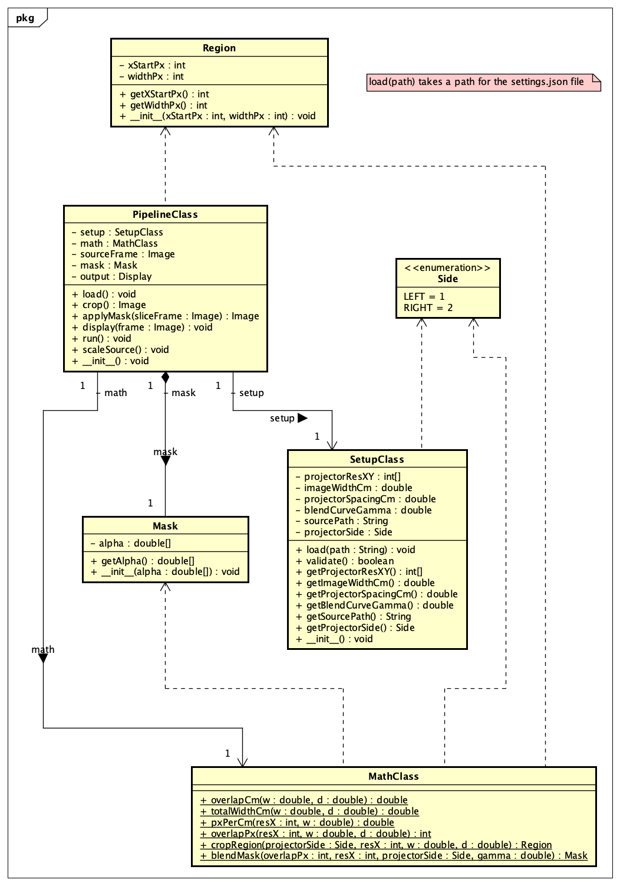
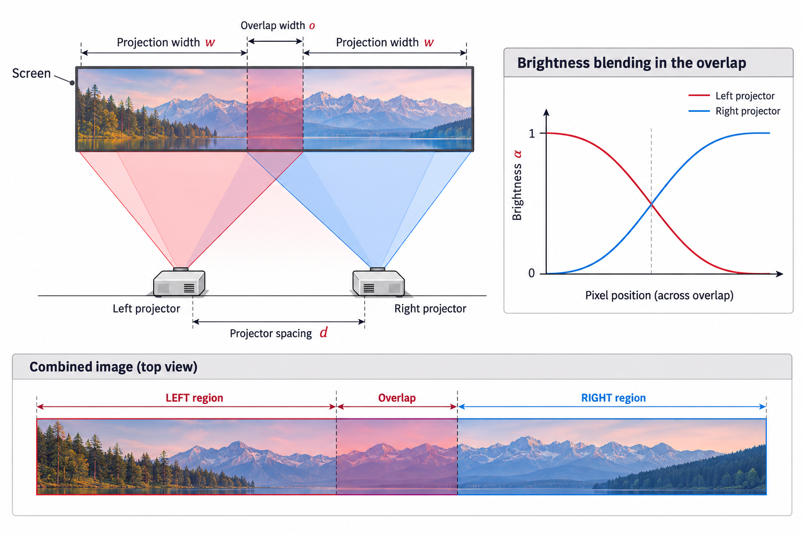

# Dual-Projector Projection System {#System Design}

## UML class diagram

The diagram below shows the main classes, their relationships, and the
methods documented in this project.

## UML Architectural Diagram

This digital illustration summarizes the two-projector arrangement, the
overlap on the screen, the opposing brightness fades, and how the
combined image is divided into left, overlap, and right regions.

## Main classes

-   **`PipelineClass`** coordinates the image-processing pipeline.
-   **`SetupClass`** loads and validates settings such as projector
    resolution, image width, projector spacing, blending gamma, source
    path, and projector side.
-   **`MathClass`** calculates overlap width, total projection width,
    pixel density, overlap pixels, image regions, and blending masks.
-   **`Region`** represents a horizontal region using its starting pixel
    and width.
-   **`Mask`** stores per-column brightness multipliers.
-   **`Side`** identifies the left (`LEFT = 1`) or right (`RIGHT = 2`)
    projector.

## Documentation navigation

Use the class list and file list generated by Doxygen to browse the API
documentation. Start with `MathClass` for geometry and mask
calculations, or `SetupClass` for configuration loading and validation.
